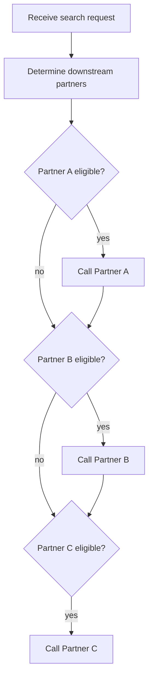

# Flow Docs Ideas: Decision Points + Markdown Reports

Oct 20, 2026 · Ideas only, nothing built yet

Two possible extensions to the flow docs in `main-app`:

1. Capture the key decisions in the code, not just the steps.
2. Generate one markdown page per scenario, with the diagram, the payloads and the partner calls.

Both reuse what's already there: the `@FlowStep` interceptor, `FlowRecorder`, and the `Snapshots`
check that fails the build when a committed doc is stale.

**Recommended first slice:** `@FlowDecision` with reasons (ideas 1 and 2 below), plus the
per-scenario markdown page.

## Part 1: capturing decision points

Today the diagrams show what happened, but not why. Partner eligibility lives in
`PartnerXService.shouldCall`, which isn't annotated. The only trace of it is the hand-written
`when = "..."` text on each client's `@FlowStep`.

### 1. `@FlowDecision` on the eligibility methods

This is the core idea.

```java
@FlowDecision(question = "Partner A eligible?", participant = Participant.ROUTER, gates = "Call Partner A")
public boolean shouldCall(RequestDto request) { ... }
```

- **Recording.** The same interceptor wraps decision methods and records the return value as an
  observation tag, for example `flow.outcome=yes`.
- **Static graph.** Each decision becomes a diamond.
  - The "yes" edge goes to the step it gates.
  - The "no" edge goes to the next decision.
  - The graph then shows the real A → B → C order, which today's three parallel arrows from
    "Determine downstream partners" hide.
- **Scenario diagrams.** Skipped partners appear too, for example
  `Note over ROUTER: Partner B eligible? no`. Readers see what didn't happen, not just what did.
- **No more drift.** Decisions replace the hand-written `when` strings, which can fall out of sync
  with the code.
- **Why `gates` is explicit.** Bytecode analysis shows that `Router.route` calls both `shouldCall`
  and `call`, but not which branch leads where. Naming the gated step is honest, and ArchUnit can
  check that the name refers to a real step.

Static graph sketch:



### 2. Record why, not just yes or no

- `shouldCall` could return a small record instead of a boolean, for example
  `Decision.skip("no PNumber")` or `Decision.call("SSN + valid passport")`.
- The reason goes into the scenario diagram's note and the static graph's "no" edge label.
- **Cost:** three method signatures change, along with `Router` and the service tests.
- **Payoff:** every skipped partner explains itself.

### 3. Decisions with more than two outcomes

For a step that picks one of several paths, such as which document to use:

```java
@FlowDecision(question = "Which document?", participant = Participant.ROUTER, outcomes = {
        @Outcome(value = "PASSPORT", next = "Call Partner A"),
        @Outcome(value = "NONE", next = "Skip")})
```

- **Static graph:** one edge per outcome.
- **Scenario diagram:** the outcome actually taken.

We don't need this today, because every current decision is yes/no. It's worth it once a decision
picks between partners rather than gating each one.

### 4. Paths that are invisible today

- **Validation failures (400).** Validation fails before the controller method runs, so no step is
  recorded. That's why there's no `invalid-request` scenario. A small explicit validation step
  would make the 400 path visible and let us add that scenario.
- **The 502 mapping.** The failure diagram currently ends in `ROUTER--xUPSTREAM: InternalServerError`
  (the exception name), even though the caller gets a 502. Annotating `SearchExceptionHandler` as a
  step ("Map partner failure to 502") would end the diagram in what the caller actually sees.

### 5. Notes from inside a step

Use these sparingly.

- A helper call, for example `FlowNotes.note("Used passport FA0000001")`, adds an event to the step
  that's currently running.
- The scenario diagram renders it as a `Note`.
- It suits facts that aren't really decisions, like which document was chosen.
- It's imperative rather than declarative, so allow it only in a few places and mask identifiers.

### Enforcement rules to add

These go into `FlowStepCoverageTest`:

| Rule | Catches |
| --- | --- |
| `eligibilityChecksAreDecisions` | A `shouldCall` without `@FlowDecision` |
| `decisionTargetsExist` | A `gates` or `next` naming a step that doesn't exist |
| `questionsAreUnique` | Two decisions whose questions slug to the same id |
| `decisionsAreProxyable` | The existing proxyable and no-self-invocation rules, applied to decisions |

## Part 2: a markdown page per scenario

Generate `main-app/docs/flows/<scenario>.md` with the Mermaid diagram inside a fenced block.

- GitHub renders fenced `mermaid` blocks, so pages read well in a PR.
- The existing snapshot check covers them, so a changed payload shows up in the diff, not just a
  changed path.

### Page contents

1. **Title and description**, from the file name and the scenario's `description`.
2. **Summary line:** expected status vs. actual, and which partners were called.
3. **Request:** the incoming `/search` payload, as formatted JSON.
4. **Decisions table**, filled from Part 1:

   | Decision | Outcome | Reason |
   | --- | --- | --- |
   | Partner A eligible? | yes | SSN + valid passport |
   | Partner B eligible? | no | no PNumber |
   | Partner C eligible? | yes | SSN |

5. **Sequence diagram.**
6. **Partner calls**, one section per call. These come from WireMock's request log
   (`partners.getAllServeEvents()`), not from the stub definitions, so they show what was actually
   sent:
   - the request body the router sent
   - which stub matched
   - the response WireMock returned
7. **Unmatched requests.** Shown only when a partner call matched no stub, as a warning. A missing
   stub becomes obvious.
8. **Router response:** the final `/search` response body, which MockMvc already has.

Long JSON goes in collapsible `<details>` blocks so the page stays scannable.

### Example (abridged)

````markdown
# a-and-c

SSN and valid passport but no PNumber: A and C are called, B is skipped

**Status:** 200 (expected 200) · **Partners called:** A, C

## Request

<details><summary>POST /search</summary>

```json
{ "header": { "requestId": "a-and-c", ... }, "person": { "first": "Gil", ... } }
```
</details>

## Decisions

| Decision | Outcome | Reason |
| --- | --- | --- |
| Partner A eligible? | yes | SSN + valid passport |
| Partner B eligible? | no | no PNumber |
| Partner C eligible? | yes | SSN |

## Flow

```mermaid
sequenceDiagram
    ...
```

## Partner calls

### Partner A: POST /partner-a/matches → 200

<details><summary>Request sent</summary> ... </details>
<details><summary>Response returned</summary> ... </details>
````

### Index page: `main-app/docs/README.md`

- The static graph embedded at the top.
- A table of scenarios (name, description, partners called, status), each linking to its page.
- A list of every step and decision, with its source location. ArchUnit's
  `getSourceCodeLocation()` gives the file and line, so readers can jump to the code.

### Implementation shape

- `FlowScenarioDocsTest` collects a `ScenarioReport` record for each scenario: request, decisions,
  partner calls, response and diagram. A new `MarkdownRenderer` writes it out.
- `Snapshots.verifyOrUpdate` is reused unchanged.
- Output must be identical on every run, or the snapshot check fails:
  - sort JSON keys (Jackson's `ORDER_MAP_ENTRIES_BY_KEYS` and `SORT_PROPERTIES_ALPHABETICALLY`)
  - no timestamps or durations
  - partner calls listed in the order they arrived, which is safe because calls are sequential
- Once the `.md` pages exist, drop the per-scenario `.mmd` files so the same diagram isn't
  snapshotted twice. Keep `flow.mmd` for tooling, and also embed it in the index page.

### Caution: payloads in docs

These pages publish request and response payloads.

- The scenario data is fake today.
- If anyone ever copies a real request into a scenario, SSNs would end up in committed docs.
- A masking list in the renderer is cheap insurance: `ssn`, `pNumber`, `personId` and
  `personIdentifier` shown as the last 4 characters only. It would apply to request bodies, partner
  calls and decision notes alike.

## Open questions

- **`Decision` record vs. boolean.** Is the reason text worth changing the `shouldCall`
  signatures, or is a yes/no outcome enough for now?
- **Validation as a step.** Should the 400 path be visible in the diagrams, at the cost of moving
  validation out of Spring's argument binding and into an explicit step?
- **`.mmd` files.** Drop the per-scenario `.mmd` files once the markdown pages exist, or keep both?
- **Masking.** Mask the scenario data now, or only once there's a chance of real data?
