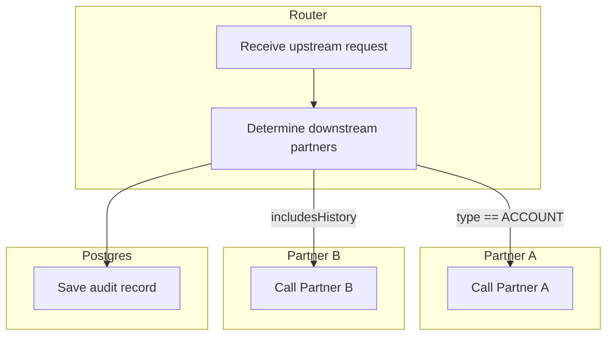
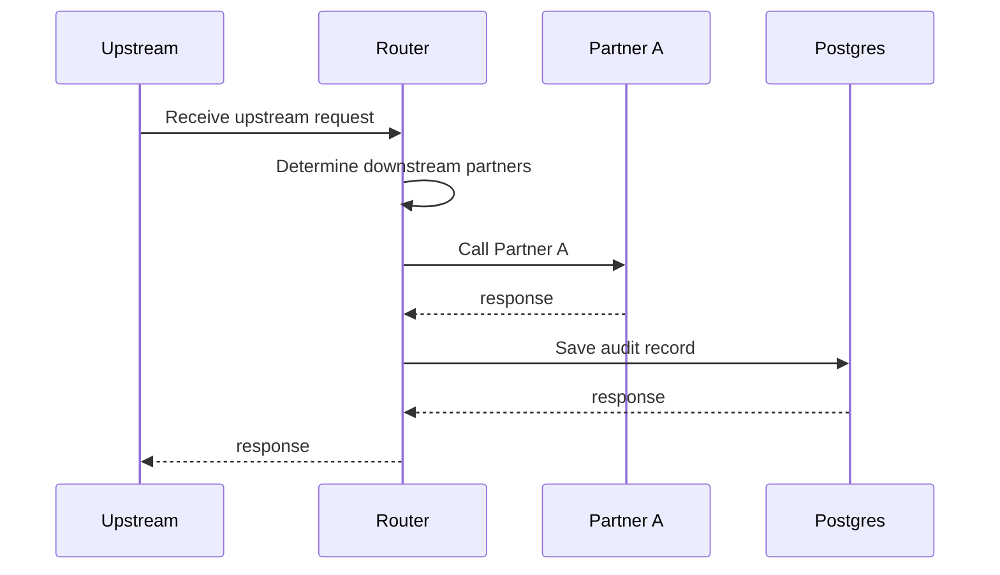

# Flow Docs from Code: @FlowStep + WireMock

Oct 13, 2026 · @Justin

## How it works

Tests generate Mermaid diagrams of the request flow into `docs/`, and the build fails whenever a committed diagram no longer matches the code. Each step is marked with one annotation that states *what* happens and *where* (which participant does it):

```java
@FlowStep(action = "Call Partner A", participant = Participant.PARTNER_A, when = "type == ACCOUNT")
```

| Diagram | File | Shows | Built from |
| --- | --- | --- | --- |
| Static graph | `docs/flow.mmd` | Every step and every possible path, grouped by participant | `@FlowStep` + ArchUnit bytecode call analysis; the app never starts |
| Scenario diagrams | `docs/flows/<scenario>.mmd` | What one request actually does, in order, including errors | Observations recorded from `@FlowStep` methods while JSON scenarios run against WireMock partners |

Key properties:

- **One annotation, no extra dependency.** A small Spring AOP interceptor turns each `@FlowStep` call into a Micrometer `Observation`. `spring-aop` already ships with Spring, so no AspectJ starter is needed.
- **Off by default.** The interceptor exists only when `flow.observations.enabled=true`. In prod the annotation is inert metadata: no proxies, no observations, no overhead.
- **Snapshot rule.** Every diagram test compares against the committed file. `./gradlew test -PupdateFlowDocs` regenerates them, and diagram diffs show up in the PR next to the code change.
- **One scenario format.** Each JSON scenario file (request, expected status, WireMock stubs) drives the scenario diagrams and, optionally, Gatling load tests.

## Setup

Only test-scope dependencies are added. The runtime side uses `spring-aop` and Micrometer Observation, both already on a Spring Boot classpath.

| Dependency | Scope | Why |
| --- | --- | --- |
| `archunit-junit5` | test | Static graph and enforcement rules |
| `wiremock-standalone` | test | Partner stubs; shaded, so no Jetty/Jackson clash with Boot 4 |

```kotlin
// build.gradle.kts
dependencies {
    testImplementation("com.tngtech.archunit:archunit-junit5:1.3.0")      // use current 1.x
    testImplementation("org.wiremock:wiremock-standalone:3.13.1")         // use current 3.x
}

tasks.test {
    systemProperty("updateFlowDocs", providers.gradleProperty("updateFlowDocs").isPresent)
    inputs.files(fileTree("docs") { include("**/*.mmd") })
}
```

```properties
# src/main/resources/application.properties: nothing needed, off by default
# flow.observations.enabled=true   # set only where you want observations (scenario tests, perf env)
```

Add `*.mmd text eol=lf` to `.gitattributes`. Confirm both artifacts are available through your internal mirror. If the app has no `ObservationRegistry` bean (check by autowiring it in a test), add `@Bean ObservationRegistry observationRegistry() { return ObservationRegistry.create(); }`.

## Main code

Three classes in `src/main/java/com/example/router/docs/`: the annotation, the participant enum, and the interceptor configuration.

```java
/** Marks a step in the request flow. Read by ArchUnit at build time and by the interceptor at runtime. */
@Documented
@Retention(RetentionPolicy.RUNTIME)
@Target(ElementType.METHOD)
public @interface FlowStep {
    String action();               // what is happening: node and message text, and the step's identity
    Participant participant();     // where: the system doing the work
    String when() default "";      // optional branch condition, shown on the incoming edge in the static graph
}

/** Systems in the flow: subgraphs in the static graph, lifelines in scenario diagrams. */
public enum Participant {
    ROUTER("Router"),
    PARTNER_A("Partner A"),
    PARTNER_B("Partner B"),
    POSTGRES("Postgres");

    private final String label;
    Participant(String label) { this.label = label; }
    public String label() { return label; }
}

@Configuration(proxyBeanMethods = false)
public class FlowStepObservationConfig {

    public static final String OBSERVATION_NAME = "flow.step";
    public static final String STEP_KEY = "flow.step";
    public static final String PARTICIPANT_KEY = "flow.participant";

    /** Off unless flow.observations.enabled=true. Without this bean, @FlowStep has no runtime effect. */
    @Bean
    @Role(BeanDefinition.ROLE_INFRASTRUCTURE)
    @ConditionalOnProperty(name = "flow.observations.enabled", havingValue = "true")
    static Advisor flowStepAdvisor(ObjectProvider<ObservationRegistry> registry) {
        MethodInterceptor interceptor = invocation -> {
            FlowStep step = AnnotatedElementUtils.findMergedAnnotation(invocation.getMethod(), FlowStep.class);
            return Observation.createNotStarted(OBSERVATION_NAME, registry.getObject())
                    .contextualName(step.action())
                    .lowCardinalityKeyValue(STEP_KEY, step.action())
                    .lowCardinalityKeyValue(PARTICIPANT_KEY, step.participant().name())
                    .observeChecked(invocation::proceed);
        };
        return new DefaultPointcutAdvisor(
                AnnotationMatchingPointcut.forMethodAnnotation(FlowStep.class), interceptor);
    }
}
```

The advisor is static and has the infrastructure role so Spring's auto-proxy creator picks it up early, the same way `@Transactional` works without AspectJ. `observeChecked` starts the observation, opens a scope (so nested steps find their parent), records any exception, and stops it.

Annotating steps:

```java
@RestController
class UpstreamController {
    @PostMapping("/requests")
    @FlowStep(action = "Receive upstream request", participant = Participant.ROUTER)
    public ResponseEntity<AggregateResponse> handle(@RequestBody UpstreamRequest req) {
        return ResponseEntity.ok(orchestrator.process(req));
    }
}

@Service
class Orchestrator {
    @FlowStep(action = "Determine downstream partners", participant = Participant.ROUTER)
    public AggregateResponse process(UpstreamRequest req) { ... }   // calls partnerA, partnerBGateway, auditLogger
}

@Component
class PartnerAClient {
    @FlowStep(action = "Call Partner A", participant = Participant.PARTNER_A, when = "type == ACCOUNT")
    public PartnerAResponse call(UpstreamRequest req) {
        return restClient.post().uri("/accounts").body(toPartnerA(req)).retrieve().body(PartnerAResponse.class);
    }
}

/** Generated clients can't be annotated: put each call behind a thin method on your own bean. */
@Component
class PartnerBGateway {
    @FlowStep(action = "Call Partner B", participant = Participant.PARTNER_B, when = "includesHistory")
    public PartnerBResponse history(String id) {
        return partnerBApi.getHistory(id);
    }
}

@Component
class AuditLogger {
    @FlowStep(action = "Save audit record", participant = Participant.POSTGRES)
    public void log(UpstreamRequest req, AggregateResponse resp) {
        repository.save(toEntity(req, resp));
    }
}
```

Rules for steps:

- **Actions are unique.** The action text is the step's identity: the static graph slugs it into a node id (`Call Partner A` → `call_partner_a`), and it's the `flow.step` tag value. Renaming an action renames the step.
- **Proxyable and called from another bean.** Non-private, non-final methods on Spring beans. A call on `this` bypasses the interceptor and the step drops out of scenario diagrams. ArchUnit enforces all three rules (see Enforcement).
- **New system, new enum value.** Add a `Participant` constant; its label is what readers see.

## Static graph

`FlowDocsTest` imports the compiled classes with ArchUnit, collects every `@FlowStep`, and walks calls between steps (through unannotated helpers and interface implementations) to render `docs/flow.mmd`. Nodes are grouped into one subgraph per participant. `Snapshots` is shared by every diagram test. Both live in `src/test/java/com/example/router/docs/`.

```java
class FlowDocsTest {

    private static final String BASE_PKG = "com.example.router";

    record Node(String id, String action, Participant participant, String when) {}

    private final Map<JavaMethod, Node> nodes = new HashMap<>();

    @Test
    void flowDiagramIsCurrent() throws Exception {
        JavaClasses classes = new ClassFileImporter()
                .withImportOption(ImportOption.Predefined.DO_NOT_INCLUDE_TESTS)
                .importPackages(BASE_PKG);
        for (JavaClass c : classes) {
            for (JavaMethod m : c.getMethods()) {
                m.tryGetAnnotationOfType(FlowStep.class).ifPresent(fs -> nodes.put(m,
                        new Node(slug(fs.action()), fs.action(), fs.participant(), fs.when())));
            }
        }
        assertFalse(nodes.isEmpty(), "No @FlowStep methods found under " + BASE_PKG);
        Snapshots.verifyOrUpdate(Path.of("docs/flow.mmd"), render());
    }

    /** "Call Partner A" -> "call_partner_a". Also used by the uniqueness rule. */
    static String slug(String action) {
        return action.toLowerCase(Locale.ROOT).replaceAll("[^a-z0-9]+", "_").replaceAll("^_+|_+$", "");
    }

    /** Follow calls through unannotated helpers until reaching other steps. */
    private Set<Node> reachable(JavaMethod start) {
        Set<Node> found = new HashSet<>();
        Set<JavaMethod> visited = new HashSet<>(Set.of(start));
        Deque<JavaMethod> stack = new ArrayDeque<>(List.of(start));
        while (!stack.isEmpty()) {
            for (JavaMethodCall call : stack.pop().getMethodCallsFromSelf()) {
                for (JavaMethod target : resolve(call)) {
                    if (target.equals(start)) continue;
                    Node node = nodes.get(target);
                    if (node != null) found.add(node);                 // stop: that step owns its edges
                    else if (visited.add(target)) stack.push(target);  // traverse helper
                }
            }
        }
        return found;
    }

    private List<JavaMethod> resolve(JavaMethodCall call) {
        return call.getTarget().resolveMember().stream()
                .filter(t -> t.getOwner().getPackageName().startsWith(BASE_PKG))
                .flatMap(this::withImplementations)
                .toList();
    }

    /** Calls through an injected interface resolve to the interface; fan out to implementations. */
    private Stream<JavaMethod> withImplementations(JavaMethod target) {
        if (!target.getOwner().isInterface()) return Stream.of(target);
        String[] params = target.getRawParameterTypes().stream().map(JavaClass::getName).toArray(String[]::new);
        return Stream.concat(Stream.of(target), target.getOwner().getAllSubclasses().stream()
                .flatMap(impl -> impl.tryGetMethod(target.getName(), params).stream()));
    }

    private String render() {
        StringBuilder sb = new StringBuilder("flowchart TD\n");

        Map<Participant, List<Node>> byParticipant = nodes.values().stream().collect(Collectors.groupingBy(
                Node::participant, () -> new EnumMap<>(Participant.class), Collectors.toList()));
        byParticipant.forEach((p, members) -> {
            sb.append("    subgraph %s[\"%s\"]\n".formatted(p.name(), escape(p.label())));
            members.stream().sorted(Comparator.comparing(Node::id))
                    .forEach(n -> sb.append("        %s[\"%s\"]\n".formatted(n.id(), escape(n.action()))));
            sb.append("    end\n");
        });

        Set<String> edges = new TreeSet<>();
        nodes.forEach((m, from) -> reachable(m).forEach(to -> edges.add(to.when().isBlank()
                ? "    %s --> %s".formatted(from.id(), to.id())
                : "    %s -->|\"%s\"| %s".formatted(from.id(), escape(to.when()), to.id()))));
        edges.forEach(e -> sb.append(e).append('\n'));
        return sb.toString();
    }

    private static String escape(String s) {
        return s.replace("\"", "#quot;");
    }
}
```

```java
final class Snapshots {

    /** With -PupdateFlowDocs, write the file; otherwise fail on any difference from the committed file. */
    static void verifyOrUpdate(Path path, String actual) throws IOException {
        if (Boolean.getBoolean("updateFlowDocs")) {
            Files.createDirectories(path.toAbsolutePath().getParent());
            Files.writeString(path, actual);
            return;
        }
        String committed = Files.exists(path) ? Files.readString(path).replace("\r\n", "\n") : "";
        assertEquals(committed, actual,
                "Flow docs out of date: " + path + ". Run ./gradlew test -PupdateFlowDocs and commit docs/");
    }

    private Snapshots() {}
}
```

Example output:



## Scenario format

Each scenario is one JSON file in `src/test/resources/flow-scenarios/`. The file name becomes the diagram name (`docs/flows/<name>.mmd`), so adding a scenario means adding a file.

| Field | Meaning |
| --- | --- |
| `description` | One line; written into the diagram as a Mermaid `%%` comment |
| `request` | The real upstream payload, posted as-is to the controller |
| `expectedStatus` | HTTP status the service must return |
| `stubs` | Partner responses, each a standard WireMock stub mapping |

`account-request.json`

```json
{
  "description": "Account lookup: Partner A only, then persist",
  "request": { "type": "ACCOUNT", "accountId": "A-123", "includesHistory": false },
  "expectedStatus": 200,
  "stubs": [
    {
      "request": {
        "method": "POST",
        "urlPath": "/partner-a/accounts",
        "bodyPatterns": [ { "matchesJsonPath": { "expression": "$.accountId", "equalTo": "A-123" } } ]
      },
      "response": { "status": 200, "jsonBody": { "accountId": "A-123", "status": "OPEN" } }
    }
  ]
}
```

`partner-a-error.json`

```json
{
  "description": "Partner A returns 500; request fails, nothing persisted",
  "request": { "type": "ACCOUNT", "accountId": "A-999", "includesHistory": false },
  "expectedStatus": 502,
  "stubs": [
    {
      "request": {
        "method": "POST",
        "urlPath": "/partner-a/accounts",
        "bodyPatterns": [ { "matchesJsonPath": { "expression": "$.accountId", "equalTo": "A-999" } } ]
      },
      "response": { "status": 500 }
    }
  ]
}
```

Conventions:

- **Give each scenario a unique key and match on it in `bodyPatterns`** (here `accountId`). The scenario test loads one file's stubs at a time, but Gatling loads all of them together, so stubs must not overlap. Adjust the JSON path to your partner request shape.
- An unmatched partner call gets WireMock's 404 and shows up as an error arrow in the diagram, which makes a missing stub easy to spot.
- Use your service's real error status; 502 is an example.

## Scenario recording

`FlowRecorder` is a test-only `ObservationHandler` that builds the step tree as observations start and stop. It ignores observations without a `flow.step` key (such as Boot's HTTP observations) but walks through them to find a step's parent. `SequenceDiagramRenderer` turns the tree into a `sequenceDiagram`. A step on another participant gets a call and a return (`--x` with the exception name on failure), a step on the same participant becomes a self-message, and overlapping siblings form a `par` block sorted by action. Message text comes straight from the observation, so the renderer needs no lookup.

```java
public class FlowRecorder {

    static final class Step {
        final Observation.Context context;
        final String action;
        final String participant;     // Participant enum name
        final long startSeq;
        volatile long stopSeq = Long.MAX_VALUE;
        final List<Step> children = new CopyOnWriteArrayList<>();

        Step(Observation.Context context, String action, String participant, long startSeq) {
            this.context = context;
            this.action = action;
            this.participant = participant;
            this.startSeq = startSeq;
        }
    }

    private final AtomicLong seq = new AtomicLong();
    private final Map<Object, Step> byContext = Collections.synchronizedMap(new IdentityHashMap<>());
    private final List<Step> roots = new CopyOnWriteArrayList<>();

    /** A field, not a bean, so Boot doesn't auto-register it a second time. */
    final ObservationHandler<Observation.Context> handler = new ObservationHandler<>() {
        @Override public boolean supportsContext(Observation.Context ctx) { return true; }

        @Override public void onStart(Observation.Context ctx) {
            KeyValue action = ctx.getLowCardinalityKeyValue(FlowStepObservationConfig.STEP_KEY);
            KeyValue participant = ctx.getLowCardinalityKeyValue(FlowStepObservationConfig.PARTICIPANT_KEY);
            if (action == null || participant == null) return;
            Step step = new Step(ctx, action.getValue(), participant.getValue(), seq.incrementAndGet());
            byContext.put(ctx, step);
            Step parent = nearestFlowParent(ctx);
            (parent == null ? roots : parent.children).add(step);
        }

        @Override public void onStop(Observation.Context ctx) {
            Step step = byContext.get(ctx);
            if (step != null) step.stopSeq = seq.incrementAndGet();
        }
    };

    public List<Step> roots() { return List.copyOf(roots); }

    public void clear() { roots.clear(); byContext.clear(); seq.set(0); }

    private Step nearestFlowParent(Observation.ContextView ctx) {
        ObservationView parent = ctx.getParentObservation();
        while (parent != null) {
            Step s = byContext.get(parent.getContextView());
            if (s != null) return s;
            parent = parent.getContextView().getParentObservation();
        }
        return null;
    }
}

@TestConfiguration(proxyBeanMethods = false)
public class FlowRecorderConfig {
    @Bean
    FlowRecorder flowRecorder(ObservationRegistry registry) {
        FlowRecorder recorder = new FlowRecorder();
        registry.observationConfig().observationHandler(recorder.handler);
        return recorder;
    }
}
```

```java
final class SequenceDiagramRenderer {

    private static final String UPSTREAM = "UPSTREAM";

    String render(List<FlowRecorder.Step> roots) {
        List<String> participants = new ArrayList<>(List.of(UPSTREAM));
        StringBuilder body = new StringBuilder();
        renderSiblings(roots, UPSTREAM, participants, body, "    ");
        StringBuilder out = new StringBuilder("sequenceDiagram\n");
        participants.forEach(p -> out.append("    participant %s as %s\n".formatted(p, displayName(p))));
        return out.append(body).toString();
    }

    private static String displayName(String participant) {
        return UPSTREAM.equals(participant) ? "Upstream" : Participant.valueOf(participant).label();
    }

    private void renderStep(FlowRecorder.Step step, String from, List<String> participants,
                            StringBuilder out, String indent) {
        String to = step.participant;
        if (!participants.contains(to)) participants.add(to);
        out.append(indent).append("%s->>%s: %s\n".formatted(from, to, text(step)));
        renderSiblings(step.children, to, participants, out, indent);
        if (!from.equals(to)) {
            Throwable error = step.context.getError();
            out.append(indent).append(error == null
                    ? "%s-->>%s: response\n".formatted(to, from)
                    : "%s--x%s: %s\n".formatted(to, from, error.getClass().getSimpleName()));
        }
    }

    /** Children in start order; runs of overlapping calls become a par block sorted by action. */
    private void renderSiblings(List<FlowRecorder.Step> children, String from, List<String> participants,
                                StringBuilder out, String indent) {
        List<FlowRecorder.Step> ordered = children.stream()
                .sorted(Comparator.comparingLong(s -> s.startSeq)).toList();
        int i = 0;
        while (i < ordered.size()) {
            List<FlowRecorder.Step> group = new ArrayList<>(List.of(ordered.get(i)));
            long groupEnd = ordered.get(i).stopSeq;
            int j = i + 1;
            while (j < ordered.size() && ordered.get(j).startSeq < groupEnd) {
                group.add(ordered.get(j));
                groupEnd = Math.max(groupEnd, ordered.get(j).stopSeq);
                j++;
            }
            if (group.size() == 1) {
                renderStep(group.get(0), from, participants, out, indent);
            } else {
                group.sort(Comparator.comparing(s -> s.action));
                for (int k = 0; k < group.size(); k++) {
                    out.append(indent).append(k == 0 ? "par " : "and ").append(text(group.get(k))).append('\n');
                    renderStep(group.get(k), from, participants, out, indent + "    ");
                }
                out.append(indent).append("end\n");
            }
            i = j;
        }
    }

    private static String text(FlowRecorder.Step step) {
        return step.action.replace("\"", "#quot;").replace(";", "#59;");
    }
}
```

## Scenario test with WireMock

One parameterized test discovers every JSON scenario and runs it against the full Spring context, with observations switched on for this class only. Each case resets WireMock, loads that scenario's stubs, posts the request, checks the status, and snapshots the diagram.

```java
@SpringBootTest(properties = "flow.observations.enabled=true")
@AutoConfigureMockMvc   // Boot 4: import from your version's webmvc test module
@Import(FlowRecorderConfig.class)
class FlowScenarioDocsTest {

    private static final Path SCENARIOS = Path.of("src/test/resources/flow-scenarios");
    private static final JsonMapper JSON = JsonMapper.builder().build();   // Jackson 3 (tools.jackson)
    private static final SequenceDiagramRenderer RENDERER = new SequenceDiagramRenderer();

    record Scenario(String description, JsonNode request, int expectedStatus, List<JsonNode> stubs) {}

    @RegisterExtension
    static WireMockExtension partners = WireMockExtension.newInstance()
            .options(wireMockConfig().dynamicPort())
            .build();

    @DynamicPropertySource
    static void partnerUrls(DynamicPropertyRegistry registry) {
        registry.add("partners.a.base-url", () -> partners.baseUrl() + "/partner-a");   // your property names
        registry.add("partners.b.base-url", () -> partners.baseUrl() + "/partner-b");
    }

    @MockitoBean AuditRepository auditRepository;   // persist step still observed; no database
    @Autowired MockMvc mvc;
    @Autowired FlowRecorder recorder;

    static Stream<String> scenarios() throws IOException {
        try (Stream<Path> files = Files.list(SCENARIOS)) {
            return files.map(p -> p.getFileName().toString())
                    .filter(n -> n.endsWith(".json"))
                    .map(n -> n.substring(0, n.length() - ".json".length()))
                    .sorted().toList().stream();
        }
    }

    @ParameterizedTest(name = "{0}")
    @MethodSource("scenarios")
    void scenario(String name) throws Exception {
        Scenario s = JSON.readValue(Files.readString(SCENARIOS.resolve(name + ".json")), Scenario.class);

        partners.resetAll();
        recorder.clear();
        for (JsonNode stub : s.stubs()) {
            partners.getRuntimeInfo().getWireMock().register(StubMapping.buildFrom(stub.toString()));
        }

        mvc.perform(post("/requests").contentType(MediaType.APPLICATION_JSON).content(s.request().toString()))
                .andExpect(status().is(s.expectedStatus()));

        String diagram = RENDERER.render(recorder.roots())
                .replaceFirst("\n", "\n    %% " + s.description() + "\n");
        Snapshots.verifyOrUpdate(Path.of("docs/flows/" + name + ".mmd"), diagram);
    }
}
```

The repository is mocked, but the partner clients are not: their `@FlowStep` methods are the steps being observed, so they must run for real against WireMock. Output for `account-request`:



## Enforcement rules

These rules make the annotation hard to misuse. They run as ordinary tests, without starting the app.

| Rule | Catches |
| --- | --- |
| `downstreamCallsAreSteps` | A new partner call that isn't a documented step |
| `actionsAreUnique` | Two steps whose actions slug to the same id |
| `stepsAreProxyable` | Private or final steps the interceptor can't reach |
| `noSelfInvocation` | A step called from its own class, which bypasses the proxy |

```java
@AnalyzeClasses(packages = "com.example.router", importOptions = ImportOption.DoNotIncludeTests.class)
class FlowStepCoverageTest {

    @ArchTest
    static final ArchRule downstreamCallsAreSteps =
            methods().that().areDeclaredInClassesThat().resideInAPackage("..downstream..")
                    .and().arePublic()
                    .and().areDeclaredInClassesThat().areNotInterfaces()
                    .should().beAnnotatedWith(FlowStep.class);

    @ArchTest
    static void actionsAreUnique(JavaClasses classes) {
        Map<String, List<String>> bySlug = new TreeMap<>();
        classes.stream()
                .flatMap(c -> c.getMethods().stream())
                .filter(m -> m.isAnnotatedWith(FlowStep.class))
                .forEach(m -> bySlug
                        .computeIfAbsent(FlowDocsTest.slug(m.getAnnotationOfType(FlowStep.class).action()),
                                k -> new ArrayList<>())
                        .add(m.getFullName()));
        bySlug.values().removeIf(methods -> methods.size() < 2);
        assertTrue(bySlug.isEmpty(), "Duplicate @FlowStep actions: " + bySlug);
    }

    @ArchTest
    static final ArchRule stepsAreProxyable =
            methods().that().areAnnotatedWith(FlowStep.class)
                    .should().notHaveModifier(JavaModifier.PRIVATE)
                    .andShould().notHaveModifier(JavaModifier.FINAL);

    @ArchTest
    static final ArchRule noSelfInvocation =
            methods().that().areAnnotatedWith(FlowStep.class).should(notBeCalledFromOwnClass());

    private static ArchCondition<JavaMethod> notBeCalledFromOwnClass() {
        return new ArchCondition<>("not be called from its own class") {
            @Override
            public void check(JavaMethod method, ConditionEvents events) {
                method.getCallsOfSelf().stream()
                        .filter(call -> call.getOriginOwner().equals(method.getOwner()))
                        .forEach(call -> events.add(SimpleConditionEvent.violated(method,
                                "Self-invocation bypasses the @FlowStep interceptor: " + call.getDescription())));
            }
        };
    }
}
```

There's no rule keeping a second annotation in sync with `@FlowStep`, because there's only one annotation.

## Workflow and file layout

| Situation | What to do |
| --- | --- |
| Normal build / CI (Harness) | `./gradlew build`. Fails if any `.mmd` in `docs/` is stale or a rule is broken. |
| Flow changed on purpose | `./gradlew test -PupdateFlowDocs`, review the rendered diagrams, commit `docs/` with the code. |
| New step | Add `@FlowStep(action, participant[, when])` to a public method on a bean, then regenerate. |
| New downstream system | Add a `Participant` value, then annotate its steps. |
| New scenario | Add a JSON file to `flow-scenarios/`, then regenerate. |
| First run ever | No committed diagrams yet, so the build fails. Regenerate once and commit. |

In PR review, a changed `docs/flow.mmd` means the possible paths changed. A changed `docs/flows/*.mmd` means behavior for that request changed.

```
your-service/
├── .gitattributes                         ← *.mmd text eol=lf
├── docs/
│   ├── flow.mmd                           ← static graph
│   └── flows/<scenario>.mmd               ← one per JSON scenario
└── src/
    ├── main/java/com/example/router/docs/
    │   ├── FlowStep.java
    │   ├── Participant.java
    │   └── FlowStepObservationConfig.java
    ├── test/java/com/example/router/docs/
    │   ├── FlowDocsTest.java
    │   ├── Snapshots.java
    │   ├── FlowRecorder.java
    │   ├── FlowRecorderConfig.java
    │   ├── SequenceDiagramRenderer.java
    │   ├── FlowScenarioDocsTest.java
    │   └── FlowStepCoverageTest.java
    ├── test/resources/flow-scenarios/*.json
    └── gatling/java/.../FlowScenariosSimulation.java   ← optional, see below
```

## Load testing with Gatling

Gatling can reuse the same JSON scenarios as a load mix, with WireMock standing in for the partners. With observations enabled in the perf environment, every step also produces a `flow.step` timer, so you get per-step latency under load rather than one end-to-end number. This is optional, needs Gatling approved (Apache 2.0), and runs as a separate Harness stage, not on every build.

| Piece | Role |
| --- | --- |
| WireMock standalone (jar or `wiremock/wiremock` container) | Partner stand-in, loaded with every scenario's stubs |
| The app, deployed with `flow.observations.enabled=true` + Actuator | Emits `flow.step` timers tagged by `flow.step` and `flow.participant` |
| `FlowScenariosSimulation` | Feeds the JSON scenarios as load, checks each expected status, asserts global latency and error rate |

```kotlin
// build.gradle.kts
plugins {
    id("io.gatling.gradle") version "3.13.5"   // use current; simulations go in src/gatling/java
}
```

```java
public class FlowScenariosSimulation extends Simulation {

    private static final Path SCENARIOS = Path.of("src/test/resources/flow-scenarios");
    private static final String APP_URL = env("APP_URL", "http://localhost:8080");
    private static final String WIREMOCK_URL = env("WIREMOCK_URL", "http://localhost:8089");
    private static final int PARTNER_DELAY_MS = Integer.parseInt(env("PARTNER_DELAY_MS", "0"));
    private static final ObjectMapper JSON = new ObjectMapper();   // Jackson 2, bundled with Gatling

    private static final List<Map<String, Object>> SCENARIO_DATA = loadScenarios();

    /** Load every scenario's stubs into WireMock once, optionally adding partner latency. */
    @Override
    public void before() {
        HttpClient client = HttpClient.newHttpClient();
        post(client, "/__admin/reset", "");
        for (Map<String, Object> s : SCENARIO_DATA) {
            for (JsonNode stub : (JsonNode) s.get("stubs")) {
                ObjectNode copy = stub.deepCopy();
                if (PARTNER_DELAY_MS > 0) {
                    ((ObjectNode) copy.path("response")).put("fixedDelayMilliseconds", PARTNER_DELAY_MS);
                }
                post(client, "/__admin/mappings", copy.toString());
            }
        }
    }

    private final ScenarioBuilder flows = scenario("Flow scenarios")
            .feed(listFeeder(SCENARIO_DATA).circular())
            .exec(http("#{name}")
                    .post("/requests")
                    .body(StringBody("#{body}"))
                    .check(status().is(session -> session.getInt("status"))));

    {
        setUp(flows.injectOpen(rampUsersPerSec(1).to(20).during(Duration.ofSeconds(60))))
                .protocols(http.baseUrl(APP_URL).contentTypeHeader("application/json"))
                .assertions(
                        global().responseTime().percentile(95.0).lt(800),
                        global().failedRequests().percent().lt(1.0));
    }

    private static List<Map<String, Object>> loadScenarios() {
        try (Stream<Path> files = Files.list(SCENARIOS)) {
            return files.filter(p -> p.toString().endsWith(".json")).sorted().map(p -> {
                JsonNode s = read(p);
                return Map.<String, Object>of(
                        "name", p.getFileName().toString().replace(".json", ""),
                        "body", s.get("request").toString(),
                        "status", s.get("expectedStatus").asInt(),
                        "stubs", s.get("stubs"));
            }).toList();
        } catch (IOException e) {
            throw new UncheckedIOException(e);
        }
    }

    private static JsonNode read(Path p) {
        try { return JSON.readTree(p.toFile()); } catch (IOException e) { throw new UncheckedIOException(e); }
    }

    private static void post(HttpClient client, String path, String body) {
        try {
            HttpResponse<String> r = client.send(HttpRequest.newBuilder(URI.create(WIREMOCK_URL + path))
                    .POST(HttpRequest.BodyPublishers.ofString(body)).build(), HttpResponse.BodyHandlers.ofString());
            if (r.statusCode() >= 300) throw new IllegalStateException(path + " -> " + r.statusCode() + ": " + r.body());
        } catch (IOException | InterruptedException e) {
            throw new IllegalStateException("WireMock admin call failed: " + path, e);
        }
    }

    private static String env(String name, String fallback) {
        String v = System.getenv(name);
        return v == null || v.isBlank() ? fallback : v;
    }
}
```

Running it:

1. Start WireMock, e.g. `java -jar wiremock-standalone-3.x.jar --port 8089`.
2. Start the app with partner base URLs pointing at WireMock, `flow.observations.enabled=true`, and Actuator metrics on.
3. Run `APP_URL=... WIREMOCK_URL=... PARTNER_DELAY_MS=150 ./gradlew gatlingRun`.
4. Read Gatling's HTML report for end-to-end latency. For per-step latency, read the `flow.step` timer: its `flow.step` tag is the action text and its `flow.participant` tag is the enum name, e.g. `/actuator/metrics/flow.step?tag=flow.participant:PARTNER_A`, or query your metrics backend.

The all-stubs-at-once load is why each scenario's stubs must match on a unique request key. `PARTNER_DELAY_MS` adds realistic partner latency only during load runs, so the scenario tests stay fast.

## Watch-outs

- [ ] **Interceptor really is off in prod.** With the property unset, `AopUtils.isAopProxy(partnerAClient)` should be false (unless something else proxies it). With it set to `true` in the scenario test, it should be true. If it's still false there, check that the advisor bean is `static` with the infrastructure role.
- [ ] **Self-invocation** silently drops a step from scenario diagrams. `noSelfInvocation` catches it at build time.
- [ ] **Interface-based proxies.** Boot proxies classes (CGLIB) by default, so the interceptor sees the annotated class method. If you've set `spring.aop.proxy-target-class=false`, put `@FlowStep` on the interface method as well, or resolve the most specific method in the interceptor.
- [ ] **Thread hops.** If partner steps appear as top-level calls from `Upstream`, the parent observation was lost on an executor. Decorate it with `ContextPropagatingTaskDecorator` (needs `io.micrometer:context-propagation`).
- [ ] **Action text is identity.** Renaming an action renames the node, the scenario messages, and the metric tag value. Avoid actions that slug to Mermaid keywords (`end`, `subgraph`).
- [ ] **API names by version.** WireMock 3: `getWireMock().register(...)` / `StubMapping.buildFrom(...)`. Micrometer 1.x: `observeChecked`, `getLowCardinalityKeyValue`, `getParentObservation`. ArchUnit 1.x: `resolveMember`, `tryGetMethod`, `getCallsOfSelf`, `@ArchTest` methods taking `JavaClasses`. Jackson 3 in tests (`tools.jackson`); Gatling bundles Jackson 2.
- [ ] **Boot 4 test imports.** `@AutoConfigureMockMvc` moved to a per-technology test module. `@MockitoBean` replaces `@MockBean`.
- [ ] **Deterministic diagrams.** No random stub delays in scenario files, and no JUnit parallel execution for `FlowScenarioDocsTest`. Run `./gradlew test` twice; a second-run diff means nondeterminism.
- [ ] **Unique stub keys.** Every scenario's stubs need a `bodyPatterns` match on a key no other scenario uses, or Gatling's combined stub set will cross-match.
