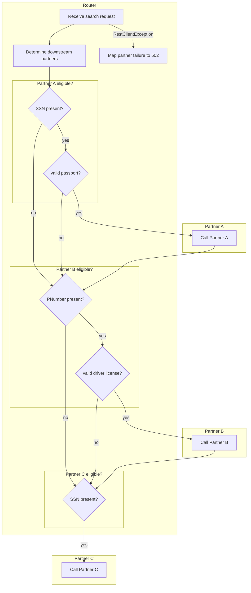

# Flow docs

Generated by the flow-docs tests. Don't edit by hand: run `./gradlew test -PupdateFlowDocs`
and commit the result.

## Flow

## Steps and decisions

| Name | Kind | Participant | Code |
| --- | --- | --- | --- |
| Call Partner A | step | Partner A | [`PartnerAService#call`](../src/main/java/com/example/router/partner/PartnerAService.java) |
| Call Partner B | step | Partner B | [`PartnerBService#call`](../src/main/java/com/example/router/partner/PartnerBService.java) |
| Call Partner C | step | Partner C | [`PartnerCService#call`](../src/main/java/com/example/router/partner/PartnerCService.java) |
| Determine downstream partners | step | Router | [`Router#route`](../src/main/java/com/example/router/Router.java) |
| Map partner failure to 502 | step | Router | [`SearchExceptionHandler#partnerCallFailed`](../src/main/java/com/example/router/SearchExceptionHandler.java) |
| Partner A eligible? | decision | Router | [`PartnerAService#shouldCall`](../src/main/java/com/example/router/partner/PartnerAService.java) |
| Partner B eligible? | decision | Router | [`PartnerBService#shouldCall`](../src/main/java/com/example/router/partner/PartnerBService.java) |
| Partner C eligible? | decision | Router | [`PartnerCService#shouldCall`](../src/main/java/com/example/router/partner/PartnerCService.java) |
| Receive search request | step | Router | [`SearchController#search`](../src/main/java/com/example/router/SearchController.java) |

## Scenarios

| Scenario | Description | Request | Expected status |
| --- | --- | --- | --- |
| [a-and-c](flows/a-and-c.md) | SSN and valid passport but no PNumber: A and C are called, B is skipped | `POST /search` | 200 |
| [all-partners](flows/all-partners.md) | SSN, PNumber, valid passport and license: A, B and C are all called | `POST /search` | 200 |
| [b-only](flows/b-only.md) | PNumber and valid license but no SSN: only B is called | `POST /search` | 200 |
| [c-only](flows/c-only.md) | SSN with a malformed passport: only C is called | `POST /search` | 200 |
| [invalid-request](flows/invalid-request.md) | Missing person.last: Spring's @Valid rejects it with 400 before the controller runs. MockMvc doesn't render the servlet container's error page, so the body here is empty | `POST /search` | 400 |
| [no-partners](flows/no-partners.md) | No SSN and no PNumber: no partner is called | `POST /search` | 200 |
| [partner-b-error](flows/partner-b-error.md) | Partner B returns 500 after A succeeds: request fails with 502 and C is never called | `POST /search` | 502 |
