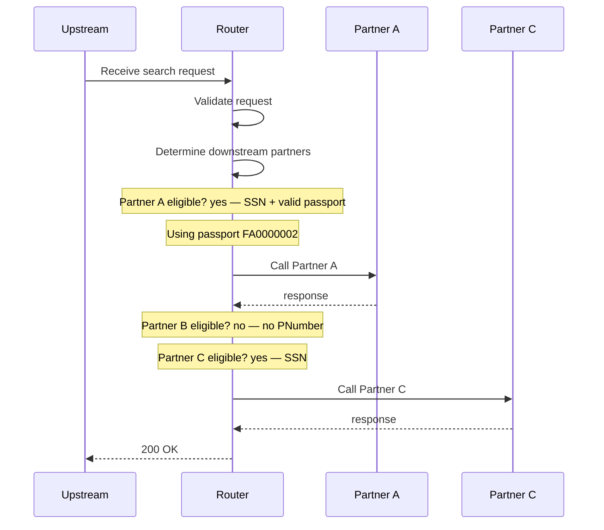

# a-and-c

SSN and valid passport but no PNumber: A and C are called, B is skipped

**Status:** 200 (expected 200) · **Partners called:** Partner A, Partner C

## Request

<details><summary>POST /search</summary>

```json
{
  "header" : {
    "requestId" : "a-and-c",
    "source" : "flow-scenario",
    "timestamp" : "2026-10-20T12:00:00Z"
  },
  "documents" : [ {
    "documentType" : "PASSPORT",
    "documentNumber" : "FA0000002"
  }, {
    "documentType" : "DRIVER_LICENSE",
    "documentNumber" : "F00000002"
  } ],
  "person" : {
    "first" : "Gil",
    "last" : "Baker",
    "ssn" : "900000002",
    "birthDate" : "1975-05-05"
  }
}
```

</details>

## Decisions

| Decision | Outcome | Reason |
| --- | --- | --- |
| Partner A eligible? | yes | SSN + valid passport |
| Partner B eligible? | no | no PNumber |
| Partner C eligible? | yes | SSN |

## Flow



## Partner calls

### Partner A: POST /partner-a/matches → 200

Matched `stubs[0]`.

<details><summary>Request sent</summary>

```json
{
  "firstName" : "Gil",
  "lastName" : "Baker",
  "documentNumber" : "FA0000002",
  "personId" : "900000002"
}
```

</details>

<details><summary>Response returned</summary>

```json
{
  "matches" : [ {
    "firstName" : "Gil",
    "lastName" : "Baker",
    "birthDate" : "1975-05-05",
    "matchProbability" : 1.0
  } ]
}
```

</details>

### Partner C: POST /partner-c/matches → 200

Matched `stubs[1]`.

<details><summary>Request sent</summary>

```json
{
  "lastName" : "Baker",
  "birthDate" : "1975-05-05",
  "personIdentifier" : "900000002"
}
```

</details>

<details><summary>Response returned</summary>

```json
{
  "matches" : [ {
    "firstName" : "Gil",
    "lastName" : "Baker",
    "birthDate" : "1975-05-05",
    "matchProbability" : 1.0
  } ]
}
```

</details>

## Router response

<details><summary>200 OK</summary>

```json
{
  "requestId" : "a-and-c",
  "results" : [ {
    "partner" : "PARTNER_A",
    "matches" : [ {
      "firstName" : "Gil",
      "lastName" : "Baker",
      "birthDate" : "1975-05-05",
      "matchProbability" : 1.0
    } ]
  }, {
    "partner" : "PARTNER_C",
    "matches" : [ {
      "firstName" : "Gil",
      "lastName" : "Baker",
      "birthDate" : "1975-05-05",
      "matchProbability" : 1.0
    } ]
  } ]
}
```

</details>
