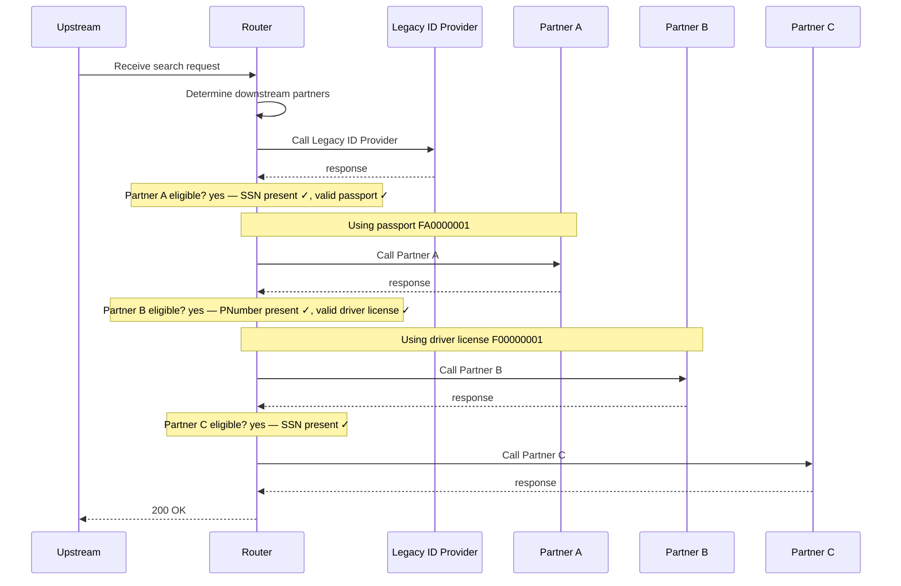

# all-partners

SSN, PNumber, valid passport and license: A, B and C are all called

**Status:** 200 (expected 200) · **Called:** Legacy ID Provider, Partner A, Partner B, Partner C

## Request

<details><summary>POST /search</summary>

```json
{
  "header" : {
    "requestId" : "all-partners",
    "source" : "flow-scenario",
    "timestamp" : "2026-10-20T12:00:00Z"
  },
  "documents" : [ {
    "documentType" : "PASSPORT",
    "documentNumber" : "FA0000001"
  }, {
    "documentType" : "DRIVER_LICENSE",
    "documentNumber" : "F00000001"
  } ],
  "person" : {
    "first" : "Fiona",
    "last" : "Ames",
    "ssn" : "900000001",
    "pNumber" : "PN900001",
    "birthDate" : "1980-01-01"
  }
}
```

</details>

## Decisions

| Decision | Outcome | Conditions |
| --- | --- | --- |
| Partner A eligible? | yes | SSN present ✓, valid passport ✓ |
| Partner B eligible? | yes | PNumber present ✓, valid driver license ✓ |
| Partner C eligible? | yes | SSN present ✓ |

## Flow



## Downstream calls

### POST /legacy-id-provider/lookup → 200

Matched `stubs[0]`.

<details><summary>Request sent</summary>

```json
{
  "firstName" : "Fiona",
  "lastName" : "Ames",
  "birthDate" : "1980-01-01",
  "ssn" : "900000001",
  "pNumber" : "PN900001"
}
```

</details>

<details><summary>Response returned</summary>

```json
{
  "personId" : "LEGACY-AMES"
}
```

</details>

### POST /partner-a/matches → 200

Matched `stubs[1]`.

<details><summary>Request sent</summary>

```json
{
  "firstName" : "Fiona",
  "lastName" : "Ames",
  "documentNumber" : "FA0000001",
  "personId" : "900000001"
}
```

</details>

<details><summary>Response returned</summary>

```json
{
  "matches" : [ {
    "firstName" : "Fiona",
    "lastName" : "Ames",
    "birthDate" : "1980-01-01",
    "matchProbability" : 1.0
  } ]
}
```

</details>

### POST /partner-b/matches → 200

Matched `stubs[2]`.

<details><summary>Request sent</summary>

```json
{
  "firstName" : "Fiona",
  "lastName" : "Ames",
  "birthDate" : "1980-01-01",
  "documentNumber" : "F00000001",
  "pNumber" : "PN900001"
}
```

</details>

<details><summary>Response returned</summary>

```json
{
  "matches" : [ {
    "firstName" : "Fiona",
    "lastName" : "Ames",
    "birthDate" : "1980-01-01",
    "matchProbability" : 1.0
  }, {
    "firstName" : "Fiona",
    "lastName" : "Amos",
    "birthDate" : "1980-01-01",
    "matchProbability" : 0.7
  } ]
}
```

</details>

### POST /partner-c/matches → 200

Matched `stubs[3]`.

<details><summary>Request sent</summary>

```json
{
  "lastName" : "Ames",
  "birthDate" : "1980-01-01",
  "personIdentifier" : "900000001"
}
```

</details>

<details><summary>Response returned</summary>

```json
{
  "matches" : [ {
    "firstName" : "Fiona",
    "lastName" : "Ames",
    "birthDate" : "1980-01-01",
    "matchProbability" : 1.0
  } ]
}
```

</details>

## Response

<details><summary>200 OK</summary>

```json
{
  "requestId" : "all-partners",
  "personId" : "LEGACY-AMES",
  "results" : [ {
    "partner" : "PARTNER_A",
    "matches" : [ {
      "firstName" : "Fiona",
      "lastName" : "Ames",
      "birthDate" : "1980-01-01",
      "matchProbability" : 1.0
    } ]
  }, {
    "partner" : "PARTNER_B",
    "matches" : [ {
      "firstName" : "Fiona",
      "lastName" : "Ames",
      "birthDate" : "1980-01-01",
      "matchProbability" : 1.0
    }, {
      "firstName" : "Fiona",
      "lastName" : "Amos",
      "birthDate" : "1980-01-01",
      "matchProbability" : 0.7
    } ]
  }, {
    "partner" : "PARTNER_C",
    "matches" : [ {
      "firstName" : "Fiona",
      "lastName" : "Ames",
      "birthDate" : "1980-01-01",
      "matchProbability" : 1.0
    } ]
  } ]
}
```

</details>
