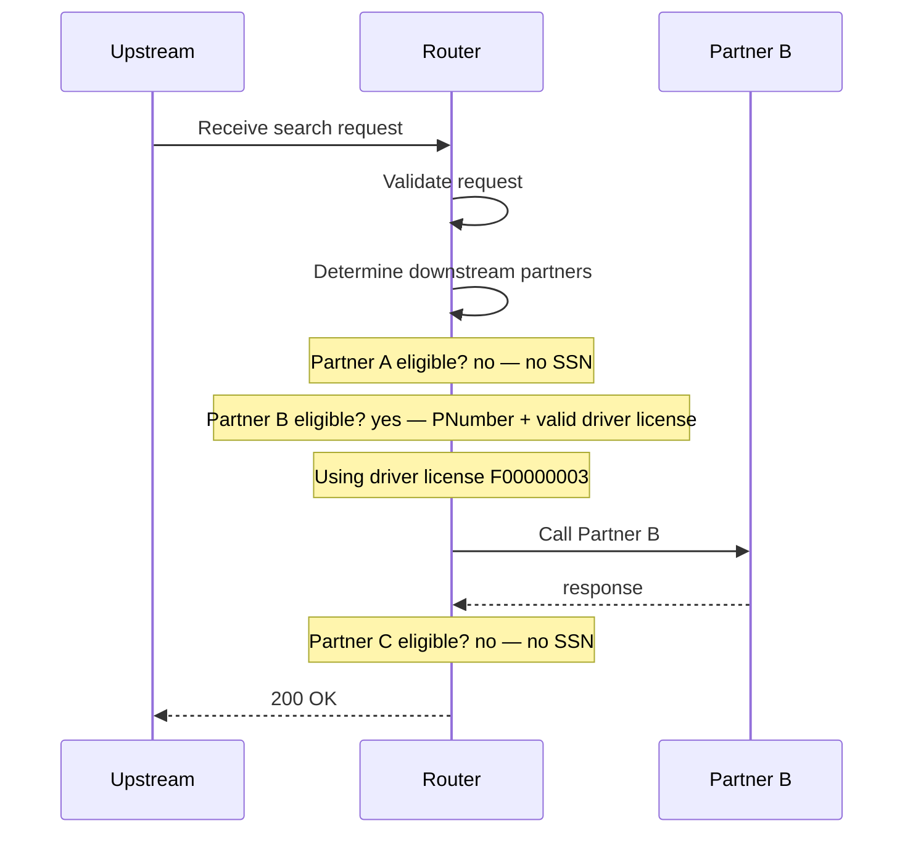

# b-only

PNumber and valid license but no SSN: only B is called

**Status:** 200 (expected 200) · **Partners called:** Partner B

## Request

<details><summary>POST /search</summary>

```json
{
  "header" : {
    "requestId" : "b-only",
    "source" : "flow-scenario",
    "timestamp" : "2026-10-20T12:00:00Z"
  },
  "documents" : [ {
    "documentType" : "DRIVER_LICENSE",
    "documentNumber" : "F00000003"
  } ],
  "person" : {
    "first" : "Hana",
    "last" : "Cole",
    "pNumber" : "PN900003",
    "birthDate" : "1990-09-09"
  }
}
```

</details>

## Decisions

| Decision | Outcome | Reason |
| --- | --- | --- |
| Partner A eligible? | no | no SSN |
| Partner B eligible? | yes | PNumber + valid driver license |
| Partner C eligible? | no | no SSN |

## Flow



## Partner calls

### Partner B: POST /partner-b/matches → 200

Matched `stubs[0]`.

<details><summary>Request sent</summary>

```json
{
  "firstName" : "Hana",
  "lastName" : "Cole",
  "birthDate" : "1990-09-09",
  "documentNumber" : "F00000003",
  "pNumber" : "PN900003"
}
```

</details>

<details><summary>Response returned</summary>

```json
{
  "matches" : [ {
    "firstName" : "Hana",
    "lastName" : "Cole",
    "birthDate" : "1990-09-09",
    "matchProbability" : 1.0
  } ]
}
```

</details>

## Router response

<details><summary>200 OK</summary>

```json
{
  "requestId" : "b-only",
  "results" : [ {
    "partner" : "PARTNER_B",
    "matches" : [ {
      "firstName" : "Hana",
      "lastName" : "Cole",
      "birthDate" : "1990-09-09",
      "matchProbability" : 1.0
    } ]
  } ]
}
```

</details>
