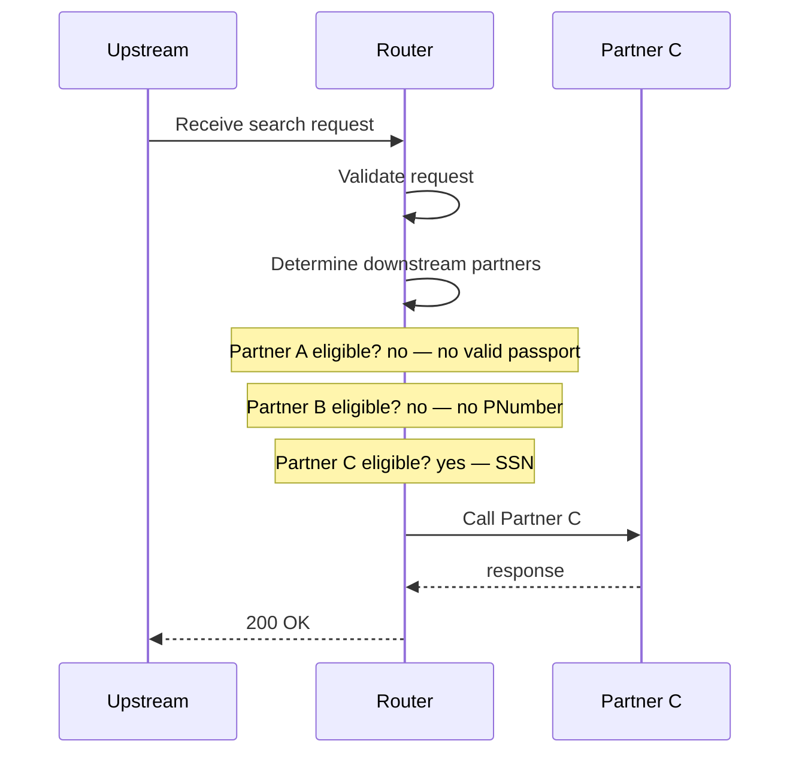

# c-only

SSN with a malformed passport: only C is called

**Status:** 200 (expected 200) · **Partners called:** Partner C

## Request

<details><summary>POST /search</summary>

```json
{
  "header" : {
    "requestId" : "c-only",
    "source" : "flow-scenario",
    "timestamp" : "2026-10-20T12:00:00Z"
  },
  "documents" : [ {
    "documentType" : "PASSPORT",
    "documentNumber" : "BAD"
  } ],
  "person" : {
    "first" : "Ivan",
    "last" : "Diaz",
    "ssn" : "900000004",
    "birthDate" : "1985-03-03"
  }
}
```

</details>

## Decisions

| Decision | Outcome | Reason |
| --- | --- | --- |
| Partner A eligible? | no | no valid passport |
| Partner B eligible? | no | no PNumber |
| Partner C eligible? | yes | SSN |

## Flow



## Partner calls

### Partner C: POST /partner-c/matches → 200

Matched `stubs[0]`.

<details><summary>Request sent</summary>

```json
{
  "lastName" : "Diaz",
  "birthDate" : "1985-03-03",
  "personIdentifier" : "900000004"
}
```

</details>

<details><summary>Response returned</summary>

```json
{
  "matches" : [ ]
}
```

</details>

## Router response

<details><summary>200 OK</summary>

```json
{
  "requestId" : "c-only",
  "results" : [ {
    "partner" : "PARTNER_C",
    "matches" : [ ]
  } ]
}
```

</details>
