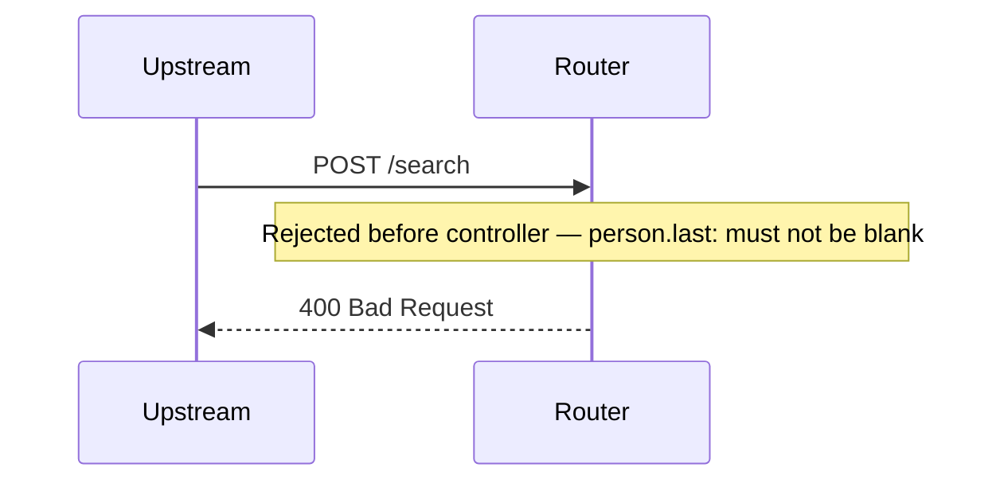

# invalid-request

Missing person.last: Spring's @Valid rejects it with 400 before the controller runs. MockMvc doesn't render the servlet container's error page, so the body here is empty

**Status:** 400 (expected 400) · **Called:** none

## Request

<details><summary>POST /search</summary>

```json
{
  "header" : {
    "requestId" : "invalid-request",
    "source" : "flow-scenario",
    "timestamp" : "2026-10-20T12:00:00Z"
  },
  "documents" : [ {
    "documentType" : "PASSPORT",
    "documentNumber" : "FA0000007"
  } ],
  "person" : {
    "first" : "Lee",
    "ssn" : "900000007",
    "birthDate" : "1995-02-02"
  }
}
```

</details>

## Decisions

None reached.

## Flow



## Downstream calls

None.

## Response

<details><summary>400 Bad Request</summary>

_Empty body._

</details>
