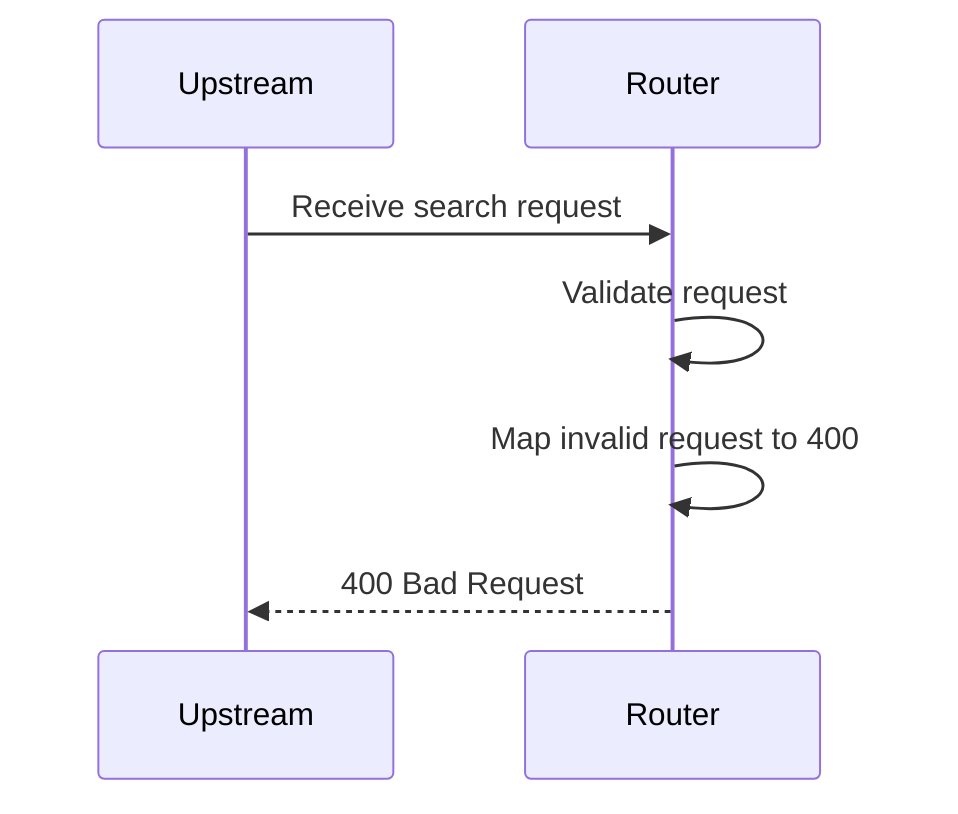

# invalid-request

Missing person.last: validation fails with 400 before any partner is considered

**Status:** 400 (expected 400) · **Partners called:** none

## Request

<details><summary>POST /search</summary>

```json
{
  "header" : {
    "requestId" : "invalid-request",
    "source" : "flow-scenario",
    "timestamp" : "2026-10-20T12:00:00Z"
  },
  "documents" : [ {
    "documentType" : "PASSPORT",
    "documentNumber" : "FA0000007"
  } ],
  "person" : {
    "first" : "Lee",
    "ssn" : "900000007",
    "birthDate" : "1995-02-02"
  }
}
```

</details>

## Decisions

None reached.

## Flow



## Partner calls

None.

## Router response

<details><summary>400 Bad Request</summary>

```json
{
  "detail" : "person.last: must not be blank",
  "instance" : "/search",
  "status" : 400,
  "title" : "Bad Request"
}
```

</details>
