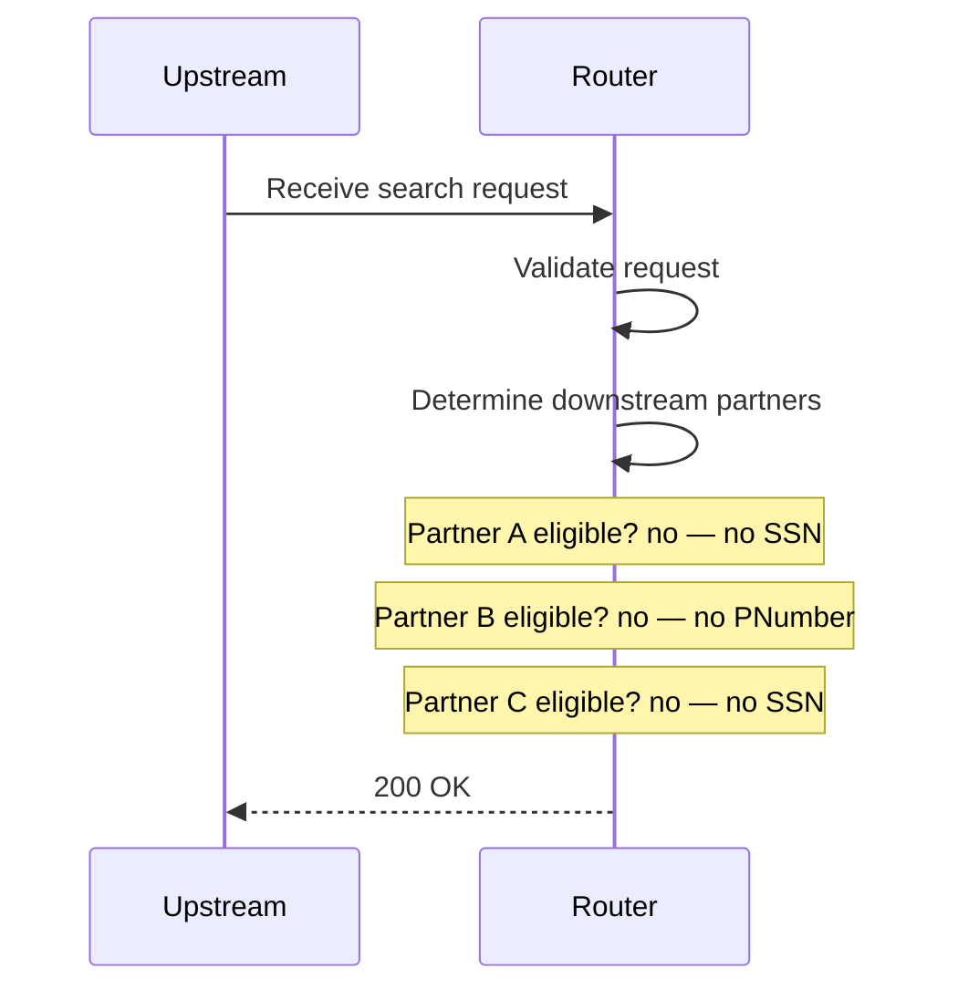

# no-partners

No SSN and no PNumber: no partner is called

**Status:** 200 (expected 200) · **Partners called:** none

## Request

<details><summary>POST /search</summary>

```json
{
  "header" : {
    "requestId" : "no-partners",
    "source" : "flow-scenario",
    "timestamp" : "2026-10-20T12:00:00Z"
  },
  "documents" : [ ],
  "person" : {
    "first" : "Jo",
    "last" : "Ellis",
    "birthDate" : "2000-01-01"
  }
}
```

</details>

## Decisions

| Decision | Outcome | Reason |
| --- | --- | --- |
| Partner A eligible? | no | no SSN |
| Partner B eligible? | no | no PNumber |
| Partner C eligible? | no | no SSN |

## Flow



## Partner calls

None.

## Router response

<details><summary>200 OK</summary>

```json
{
  "requestId" : "no-partners",
  "results" : [ ]
}
```

</details>
