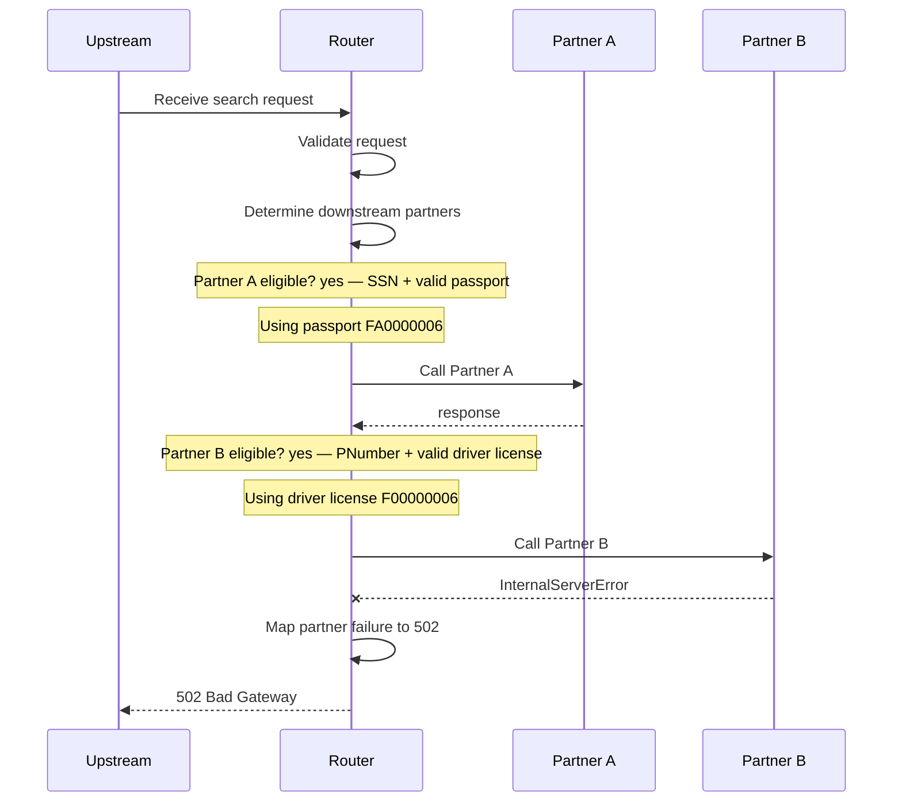

# partner-b-error

Partner B returns 500 after A succeeds: request fails with 502 and C is never called

**Status:** 502 (expected 502) · **Partners called:** Partner A, Partner B

## Request

<details><summary>POST /search</summary>

```json
{
  "header" : {
    "requestId" : "partner-b-error",
    "source" : "flow-scenario",
    "timestamp" : "2026-10-20T12:00:00Z"
  },
  "documents" : [ {
    "documentType" : "PASSPORT",
    "documentNumber" : "FA0000006"
  }, {
    "documentType" : "DRIVER_LICENSE",
    "documentNumber" : "F00000006"
  } ],
  "person" : {
    "first" : "Kai",
    "last" : "Ford",
    "ssn" : "900000006",
    "pNumber" : "PN900006",
    "birthDate" : "1970-07-07"
  }
}
```

</details>

## Decisions

| Decision | Outcome | Reason |
| --- | --- | --- |
| Partner A eligible? | yes | SSN + valid passport |
| Partner B eligible? | yes | PNumber + valid driver license |

## Flow



## Partner calls

### Partner A: POST /partner-a/matches → 200

Matched `stubs[0]`.

<details><summary>Request sent</summary>

```json
{
  "firstName" : "Kai",
  "lastName" : "Ford",
  "documentNumber" : "FA0000006",
  "personId" : "900000006"
}
```

</details>

<details><summary>Response returned</summary>

```json
{
  "matches" : [ {
    "firstName" : "Kai",
    "lastName" : "Ford",
    "birthDate" : "1970-07-07",
    "matchProbability" : 1.0
  } ]
}
```

</details>

### Partner B: POST /partner-b/matches → 500

Matched `stubs[1]`.

<details><summary>Request sent</summary>

```json
{
  "firstName" : "Kai",
  "lastName" : "Ford",
  "birthDate" : "1970-07-07",
  "documentNumber" : "F00000006",
  "pNumber" : "PN900006"
}
```

</details>

<details><summary>Response returned</summary>

_Empty body._

</details>

## Router response

<details><summary>502 Bad Gateway</summary>

```json
{
  "detail" : "Partner call failed",
  "instance" : "/search",
  "status" : 502,
  "title" : "Bad Gateway"
}
```

</details>
